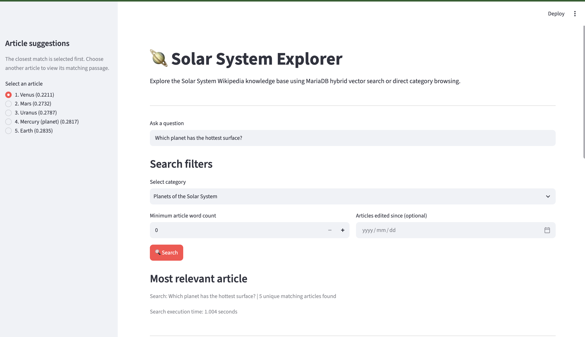
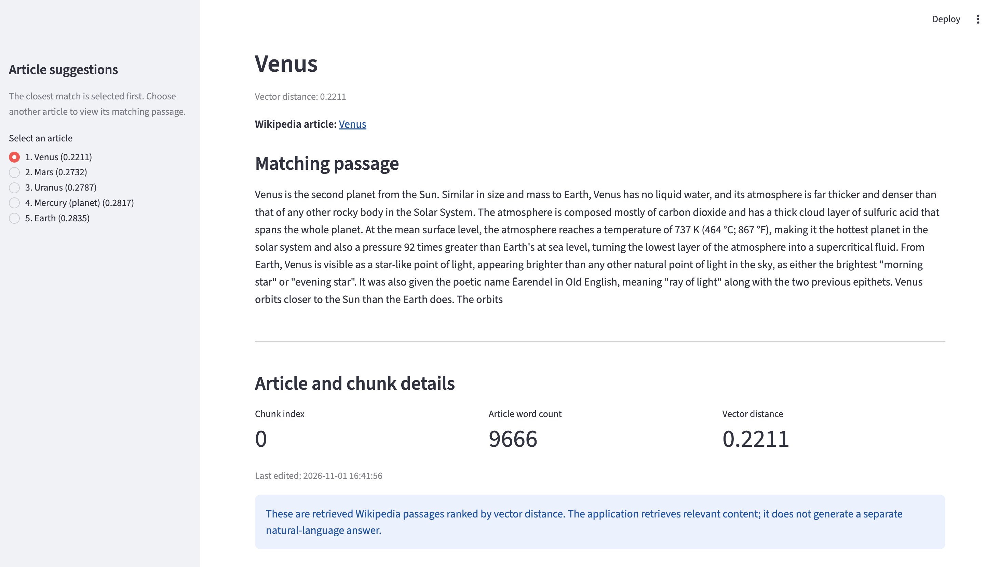
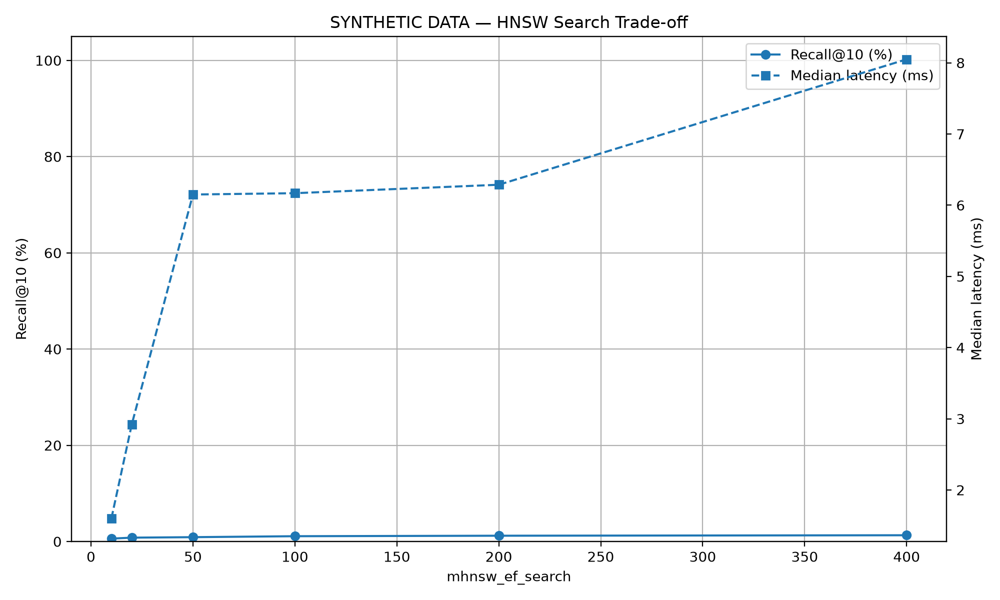
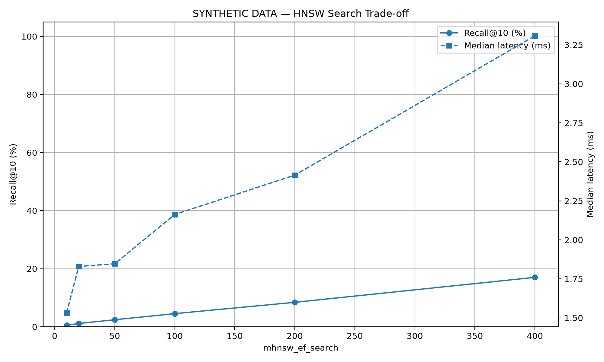
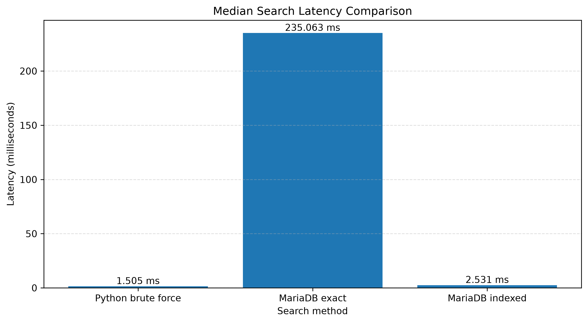

A project for area 4, "Vector search and RAG, natively" for the [MariaDB student database projects, 2026-09](https://mariadb.org/bachelor_hackathon_2026-09/).

# mighty_coders

Retrieval over Wikipedia with MariaDB's native VECTOR type.
Capstone I, Constructor University, with the MariaDB Foundation.

**The path in short:** clone → `docker compose up -d` (MariaDB 11.8) → `pip install -r requirements.txt`
→ download and load the articles (about 40 minutes) → `streamlit run python/query_ui.py` and ask a
question. Step by step: [How to run it](#how-to-run-it).

**Contents:**
[What this is](#what-this-is) ·
[What we found](#what-we-found) ·
[Versions and setup](#versions-and-setup) ·
[Data model](#data-model) ·
[Decisions](#decisions) ·
[How to run it](#how-to-run-it) ·
[Results](#results) ·
[What the database-native approach gave us](#what-the-database-native-approach-gave-us) ·
[Limits](#limits) ·
[Layout](#layout) ·
[How it was made](#how-it-was-made) ·
[Team](#team)

## What this is

Semantic search over Wikipedia articles about the Solar System, done **inside MariaDB 11.8**.
Every article is split into chunks of about 175 words, each chunk is turned into a vector of 384 numbers
(embedding model `BAAI/bge-small-en-v1.5`), and the vectors are stored in a `VECTOR(384)` column next to
the article's metadata, with a `VECTOR INDEX` (HNSW, cosine distance) over them.

A question is embedded the same way and answered with **one SQL statement** that combines the vector
search with ordinary SQL: only articles in a category, longer than N words, edited since a date, or linked
from another article, joined back to the article table. A small web page (Streamlit) lets a reader try it.
An optional RAG step sends the best chunks to an LLM and returns an answer with its sources.

## What we found

**Measured on our corpus** (166 articles, 3,753 chunks; setup in [Results](#results)):

- **The vector index is about 85× faster than exact search and lost nothing.** Median 2.8 ms vs 240 ms
  per query, and the index returned exactly the same top-5 chunks as exact search for all 44 test
  questions (index recall 1.000).
- **Retrieval quality:** for 86% of our ground-truth questions the correct article is in the top 5
  results (45% at rank 1). With the bge query instruction in front of the question: **91%** (55% at rank 1).
- **MariaDB's optimizer picks the slow plan when a filter is added.** With a filter (category, length),
  the optimizer always chose an exact scan instead of the vector index: 7–70× slower, with the same
  results. `ANALYZE TABLE` did not change it (`EXPLAIN` estimates 1 chunk per article; the real number is
  about 30). So `search()` forces the vector index by default ([table below](#filters-and-the-optimizer)).
- **`mhnsw_ef_search` made no difference on our corpus** (10, 20, 50, 100 gave identical results). At a
  few thousand chunks the index finds the true nearest neighbours with very little effort.
- **On a large index, the vector index cache decides the search quality.** On 100,000 synthetic vectors
  (384 dimensions), recall@10 stayed at about 1–2% whatever `ef_search` was, with the default
  `mhnsw_max_cache_size` of 16 MB. After `SET GLOBAL mhnsw_max_cache_size = 1073741824` (1 GB), recall
  rose with `ef_search` to about 17% at 400, and queries got faster. Rebuilding the index with the big
  cache gave the same numbers, so the cache limits the search, not the build. The documentation lists the
  variable but does not warn about this ([table below](#vector-index-cache-and-ef_search-synthetic)).

**Things the MariaDB documentation did not tell us**, all reproduced by tests in `tests/`:

- **`ON DELETE CASCADE` breaks the vector index** (MariaDB 11.8.9). After a cascade delete the index found
  only 0–1 of 15 remaining rows, for cosine and euclidean; a direct `DELETE` works.
  So `chunks` has no cascade, and the loader deletes chunks before their article
  (`test_known_bug_cascade_breaks_vector_index`).
- **Filters and `LIMIT`:** the docs say the `LIMIT` is applied before a `WHERE` filter, so rows can be
  "silently dropped". We measured no hard cap: with 300 non-matching chunks nearer than the 3 matching
  ones, matching rows still came back. But the search is approximate: with the lowest search effort it
  once returned 2 of 3. So filters go in the same statement, and `mode="exact"` is available when every row
  matters (`test_index_with_strict_filter_has_no_hard_cap`).
- **Collation matters for titles:** with the default `utf8mb4_unicode_ci`, "Titan" and "TITAN" count as
  the same title (error 1062), but Wikipedia treats them as different pages, so titles use `utf8mb4_bin`.

**Things the data taught us:**

- Wikipedia rate-limits the API (HTTP 429). The downloader waits and retries; the full download took
  about 40 minutes.
- A category can list a redirect page next to its target, which gives the same article twice; the
  downloader keeps each page id once.
- `--depth 1` of "Solar System" does not reach the planets (they sit deeper in Wikipedia's category
  tree), so we added the category "Planets of the Solar System". Big moons like Titan are still missing.
- Almost every article links to almost every other one, because of Wikipedia's navigation boxes, so the
  "linked from" filter is weak on this corpus (Io is linked from 146 of 166 articles).

## Versions and setup

- **MariaDB 11.8** (Docker image `mariadb:11.8`, tested with 11.8.9). VECTOR needs 11.7 or newer.
- **Python 3.13** with the packages in `requirements.txt`. `sentence-transformers` installs PyTorch
  (a large download).
- **Embedding model:** `BAAI/bge-small-en-v1.5`, downloaded automatically on first use (about 130 MB).
- **Dataset:** English Wikipedia, categories "Solar System" (depth 1) and "Planets of the Solar System"
  (depth 1), downloaded with the MediaWiki API. See [data/README.md](data/README.md).

## Data model

Five tables, in [`sql/init/01_vector_schema.sql`](sql/init/01_vector_schema.sql):

| Table | One row per | Key columns |
|---|---|---|
| `articles` | Wikipedia article | `id` (page id), `revision_id`, `title`, `url`, `word_count`, `last_edited` |
| `categories` | Wikipedia category | `id`, `name` |
| `article_categories` | article in a category | `article_id`, `category_id` |
| `links` | link from one corpus article to another | `from_article_id`, `to_article_id` |
| `chunks` | piece of article text | `article_id`, `chunk_index`, `word_count`, `chunk_text`, `embedding VECTOR(384)` |

Why it looks like this:

- **The Wikipedia page id is the primary key** (no `AUTO_INCREMENT`): the same article gets the same id on
  every reload.
- **`revision_id`** records which version of the text we stored, so a reload only re-chunks articles that
  changed on Wikipedia.
- **Titles use `COLLATE utf8mb4_bin`** (exact match), see above.
- **`VECTOR INDEX ... M=8 DISTANCE=cosine`**: cosine because bge-small returns normalized vectors.
  `DISTANCE=cosine` must be written, because the default is euclidean. `M=8` is our starting value
  (server default 6); at this corpus size recall was already 1.000.
- **No `ON DELETE CASCADE` on `chunks`**, see above. The other link tables use cascade (they have no vector index).
- **Normal indexes on `last_edited` and `word_count`** for the SQL filters.
- **Links are stored only between articles in the corpus.**

## Decisions

| Decision | Choice | Why |
|---|---|---|
| Embedding model | `BAAI/bge-small-en-v1.5`, 384 dims | small, free, runs locally on a laptop; good English retrieval quality for its size |
| Chunk size | 175 words, 30 words overlap (decided range 150–200) | long enough to hold one fact with its context, short enough to stay on one topic; the overlap keeps sentences that cross a boundary |
| Distance | cosine | matches the normalized vectors of the model |
| Index | HNSW, `M=8` | see Data model; `ef_search` left at the default 20 (no difference measured) |
| Search plan | vector index forced by default (`mode="index"`) | the optimizer chose the 7–70× slower exact plan with filters, same results |
| Query text | bge query instruction in front of questions (`embed_query()` in `embed.py`; chunks are embedded without it) | measured: hit@5 0.86 → 0.91, hit@1 0.45 → 0.55 |

Chunking in practice: the last chunk of each article holds the remaining words, so it can be shorter:
144 of 3,753 chunks (3.8%) are under 150 words (minimum 32). Average chunk length: 172 words.

## How to run it

### Prerequisites

- [Docker Desktop](https://www.docker.com/products/docker-desktop/) installed and running
- Python 3.13 (the versions in `requirements.txt` were tested with it) and Git
- Internet access: the setup downloads Python packages (including PyTorch, a large download), the
  embedding model (about 130 MB, on first use) and the Wikipedia articles

### Setup

**1. Clone the repository**

```bash
git clone https://github.com/yosiefgw/mighty_coders.git
cd mighty_coders
```

**2. Configure environment variables**

```bash
# macOS / Linux
cp .env.example .env

# Windows
copy .env.example .env
```

The default values work out of the box. Change `DB_PORT` only if port `3308` is already used on your
machine. `ANTHROPIC_API_KEY` is only needed for the optional RAG step.

**3. Start MariaDB**

```bash
docker compose up -d
```

MariaDB 11.8 is then available at `127.0.0.1:3308`. On the first start it creates the tables from
`sql/init/01_vector_schema.sql` (wait about 30 seconds before the next step).

To stop it:

```bash
docker compose down
```

To stop it **and delete all data** (including the loaded articles):

```bash
docker compose down -v
```

> **After pulling changes to `sql/init/`:** these files run only on the first start of an empty
> database, so recreate it, then load the data again (steps 1–2 below):
>
> ```bash
> docker compose down -v && docker compose up -d
> ```

**4. Set up the Python environment**

Create it:

```bash
# macOS / Linux
python3 -m venv .venv

# Windows
python -m venv .venv
```

Activate it:

```bash
# macOS / Linux
source .venv/bin/activate

# Windows
.venv\Scripts\activate
```

Install the dependencies:

```bash
pip install -r requirements.txt
```

**5. Check the connection**

```bash
pytest -q tests/test_smoke.py
```

Expected output:

```
1 passed
```

This test connects to the database and checks that the server is MariaDB 11.7 or newer, which the
`VECTOR` type needs. Then run the whole test suite:

```bash
pytest -q
```

With an empty database a few tests are skipped, because they need the loaded articles. After loading
the data (below), all of them run.

### Load the data and use it

> **On Windows:** the commands below are written for a macOS/Linux terminal (multi-line `python -c "…"`,
> `export`, `< file.sql`). On Windows, run them in **Git Bash** (installed with Git for Windows).

**1. Download, chunk and embed** (writes JSONL files to `data/`, about 40 minutes because of Wikipedia's rate limit):

```bash
python python/fetch.py --category "Solar System" --depth 1 --output data
python python/fetch.py --category "Planets of the Solar System" --depth 1 --output data/planets
```

**2. Load into MariaDB** (one transaction per command):

```bash
python python/load.py data/articles.jsonl data/chunks.jsonl
python python/load.py data/planets/articles.jsonl data/planets/chunks.jsonl
python python/load.py data/articles.jsonl data/chunks.jsonl     # again: now links to the planets can be stored
```

A link is stored only if its target article is already in the database, so the first file is loaded a
second time. Loading again is safe and fast: unchanged articles (same `revision_id`) keep their chunks,
only categories and links are rebuilt (in our run: 0 chunks inserted, 1,252 more links).

**3. Search in the browser:**

```bash
streamlit run python/query_ui.py        # opens http://localhost:8501
```

Type a question, optionally pick a category, a minimum word count or an "edited since" date, and get the
five best-matching articles with the matching passage and a link to Wikipedia. Without a question, a
category can be browsed directly. The time shown on the page includes turning the question into a vector
(and loading the model on the first search); the database search itself takes about 2–3 ms.





From Python, the same search:

```bash
python -c "
import sys; sys.path.insert(0, 'python')
from rag import retrieve
for r in retrieve('Which moon has geysers of water ice near its south pole?', top_k=5):
    print(round(r['distance'], 3), r['article_title'])
"
```

**4. The same hybrid queries in plain SQL:** [`sql/queries/hybrid_search_examples.sql`](sql/queries/hybrid_search_examples.sql)
(vector search, each filter, all filters together, joins, `EXPLAIN` of the three plans, index vs exact,
and a transaction demo):

```bash
docker exec -i mighty_coders_vector_db mariadb -umcuser -pmcpassword -t mighty_coders < sql/queries/hybrid_search_examples.sql
```

**5. Measure:**

```bash
python python/evaluate.py --csv docs/eval_results.csv    # ground-truth recall and latency
python python/evaluate.py --prefix                       # same, with the bge query instruction
python python/benchmarking.py                            # Python brute force vs MariaDB exact vs index (saves docs/benchmark_latency.png)
```

**Synthetic `ef_search` / cache experiment** (optional, about 5–10 minutes; builds a separate table
`synth_vectors` with 100,000 random vectors and does not touch the corpus):

```bash
python python/ef_search_experiment.py                    # with the default 16 MB cache
docker exec mighty_coders_vector_db mariadb -uroot -prootpassword -e "SET GLOBAL mhnsw_max_cache_size = 1073741824;"
python python/ef_search_experiment.py                    # again with 1 GB (the table is reused)
docker exec mighty_coders_vector_db mariadb -umcuser -pmcpassword mighty_coders -e "DROP TABLE synth_vectors;"   # clean up
```

`SET GLOBAL` needs the root user (password from `.env`) and is lost when the container restarts.

**6. RAG answer (optional, needs an Anthropic API key):** nothing reads `.env` into Python, so export the key first:

```bash
export ANTHROPIC_API_KEY=...
python -c "
import sys; sys.path.insert(0, 'python')
from rag import answer
r = answer('Why is Venus hotter than Mercury?')
print(r['answer']); print(r['sources'])
"
```

## Results

Setup for all numbers: MariaDB 11.8.9 in Docker on a MacBook Air (Apple silicon, macOS), 166 articles,
3,753 chunks, 384 dimensions. A teammate repeated the evaluation on Windows with the "Solar System" part
only (154 articles, 37 questions): hit@5 0.84 (0.89 with the query instruction), index recall 1.000,
index ~4 ms vs exact ~258 ms, so the results are reproducible.

### Ground-truth evaluation

44 questions, top k = 5, each query timed 3 times (median):

| Mode | hit@1 | hit@5 | MRR | index recall | median ms | p95 ms |
|---|---|---|---|---|---|---|
| exact (no index) | 0.45 | 0.86 | 0.61 | 1.000 | 239.6 | 243.6 |
| index, ef_search 10 | 0.45 | 0.86 | 0.61 | 1.000 | 2.77 | 2.90 |
| index, ef_search 100 | 0.45 | 0.86 | 0.61 | 1.000 | 2.88 | 3.11 |
| index + bge query instruction | 0.55 | 0.91 | 0.68 | 1.000 | 2.80 | 2.89 |

- **hit@k:** share of questions whose correct article is among the first k chunks.
  **MRR:** average of 1/rank of the first correct chunk. **Index recall:** share of the exact top-5
  chunks that the index also returned.
- Ground truth: [`eval/ground_truth.jsonl`](eval/ground_truth.jsonl), each question with the title(s) of
  the article that answers it. Full table: [`docs/eval_results.csv`](docs/eval_results.csv).

### Filters and the optimizer

Same question, with a filter, median of 5 runs. `auto` lets MariaDB's optimizer choose, `index` forces
the vector index, `exact` forbids it:

| Filter | auto | index | exact | index = exact top 5? |
|---|---|---|---|---|
| at least 3,000 words | 181.7 ms | 2.6 ms | 178.7 ms | yes |
| category, 15 articles | 37.8 ms | 2.3 ms | 37.1 ms | yes |
| category, 5 articles | 17.4 ms | 2.1 ms | 17.1 ms | yes |

`EXPLAIN` of the `auto` query (section 9 of the SQL examples) shows why: MariaDB starts from the
`word_count` index on `articles`, estimates `rows 1` chunk per article, and sorts all their chunks
(`Using temporary; Using filesort`). With `FORCE INDEX` it reads `idx_chunks_embedding` (12 rows).

### Vector index cache and ef_search (synthetic)

100,000 random normalized 384-dim vectors (fixed seed), `M=8`, `DISTANCE=cosine`, 100 random queries,
recall@10 against exact search (`IGNORE INDEX`). Two machines: Windows (teammate) and macOS.

| ef_search | 16 MB cache (default), Windows | 1 GB, Windows | 1 GB, Windows, run 2 | 16 MB, macOS | 1 GB, macOS | 1 GB, macOS, index rebuilt |
|---|---|---|---|---|---|---|
| 10 | 0.6% | 0.5% | 0.5% | 0.8% | 0.8% | 1.1% |
| 100 | 1.1% | 4.5% | 4.6% | 2.1% | 6.6% | 5.6% |
| 400 | 1.3% | 17.0% | 17.2% | 2.1% | 17.9% | 17.2% |

| 16 MB cache (default) | 1 GB cache |
|---|---|
|  |  |

- With 16 MB, more search effort barely helps: recall stays at 1–2%. With 1 GB, recall rises with
  `ef_search`, the normal HNSW trade-off, and latency at `ef_search` 400 dropped (macOS: 4.4 → 1.7 ms).
- Rebuilding the index after raising the cache gave the same recall, so the cache limits the search.
- Random 384-dim vectors are the hardest case for HNSW (all points are almost equally far apart), which is
  why even 17% is low. On our real corpus the index reached recall 1.000.
- Full numbers: [`docs/ef_search_results_16MB.csv`](docs/ef_search_results_16MB.csv),
  [`docs/ef_search_results_1GB.csv`](docs/ef_search_results_1GB.csv),
  [`docs/ef_search_results_1GB_run2.csv`](docs/ef_search_results_1GB_run2.csv).

### Python brute force vs MariaDB



`python/benchmarking.py`, 5 queries, 10 repeats: Python brute force 1.5 ms, MariaDB exact 235 ms,
MariaDB indexed 2.5 ms, indexed recall@5 100%. Python is fastest here because all 3,753 vectors are already
in memory as one numpy matrix and loading them is not timed, while the MariaDB time includes parsing the
SQL, the connection and the join to `articles`. The comparison that matters inside the database is
index vs exact (~93×). What the in-memory version does not give: filters, joins, transactions, and data
that stays in sync with the articles.

## What the database-native approach gave us

- **Hybrid search in one statement:** vector similarity, filters on other tables, and joins back to the
  article in a single SQL query. A separate vector store would need a second query to the database and
  code to merge the results.
- **Transactions cover the vectors too:** the loader replaces an article's chunks, categories and links
  in one transaction (all or nothing), and a `ROLLBACK` also removes a vector from the index
  (`test_rollback_removes_chunk_from_search`, and section 11 of the SQL examples).
- **One system to keep in sync:** article metadata and vectors live in the same rows. No second copy
  that can drift apart.
- **`EXPLAIN` works for vector queries too**, which is how we found the optimizer problem above.
- **The cost:** a database feature that is still young. The cascade problem, the optimizer's plan
  choice and the small default index cache are the clearest examples.

## Limits

- Small corpus (166 articles); latency numbers are tiny and `ef_search` showed no effect.
- The `ef_search` / cache experiment uses random vectors, the worst case for HNSW; real embeddings have
  structure and would reach higher recall. We did not measure the cache effect on real text at that size.
- `docker-compose.yml` keeps the default 16 MB cache; for an index of that size it would need to be raised.
- 44 ground-truth questions: one question is about 2 percentage points. We wrote the questions ourselves
  (with AI help) while knowing the article titles, which can make them easier than real users' questions.
- One laptop and one MariaDB version (11.8.9) for the main numbers.
- The text extract drops tables: some "List of ..." pages have fewer than 100 words.
- The corpus misses big moons with their own category (e.g. Titan).
- The "linked from" filter is weak because of navigation boxes (it is not offered in the web page).

## Layout

- `sql/init/`: numbered SQL files, run in order on first start (`01_vector_schema.sql`)
- `sql/queries/`: hybrid search examples to run by hand
- `python/`: `fetch.py` (download, chunk, embed), `load.py` (into MariaDB), `search.py` (hybrid search),
  `query_ui.py` (web page), `embed.py`, `rag.py`, `evaluate.py` (ground truth), `benchmarking.py`,
  `ef_search_experiment.py` (synthetic cache / `ef_search` experiment), `db.py`
- `eval/`: the ground-truth questions
- `tests/`: pytest tests
- `data/`: dataset instructions (downloaded files are not committed)
- `docs/`: results, charts and screenshots for this README
- `CONTRIBUTING.md`: how we work (branches, pull requests, reviews)

## How it was made

- **Work split:** database layer (schema, hybrid search, loader, SQL examples, ground truth and
  evaluation), data pipeline and RAG (download, chunking, embedding), benchmarking and the web page.
  Work went through pull requests into `dev`, reviewed by another team member.
- **Order:** schema first (tested with fake vectors), then the search function and the loader against
  an agreed JSONL file format, so the pipeline could be built in parallel. Then the real corpus, the
  ground-truth set, and the measurements.
- **Testing on real data changed the design.** The first real download found the rate-limit crash and the
  duplicate redirects; the first real searches showed the missing planets (we added a category) and the
  optimizer's slow plan with filters (we made the index the default).
- **Reviews found real bugs**, for example: integration tests that failed on an empty database,
  questions skipped too eagerly in the evaluation, and a downloader that fetched no text at all because
  of two MediaWiki API limits (one extract and no `rvlimit` per multi-page request).
- **Every finding is a test.** The cascade bug, the collation, the filter behaviour and the default plan
  are checked by `pytest` (with the corpus loaded: all tests pass).
- **AI use:** we used AI assistants (Claude) for code, tests and reviews; every result was run and checked
  on our machines. The detailed record (tools, prompts, what they produced) is in the team document.

## Team

- Yosief Gebrewahid Kidane ([@yosiefgw](https://github.com/yosiefgw)): schema, hybrid search, loader, SQL examples, ground truth and evaluation
- Timofey Stukalin ([@tstukalin1](https://github.com/tstukalin1)): download, chunking and embedding, RAG
- Dinu Panackal Devassia ([@DinuPD](https://github.com/DinuPD)): benchmarking, web page, ef_search / cache experiment
